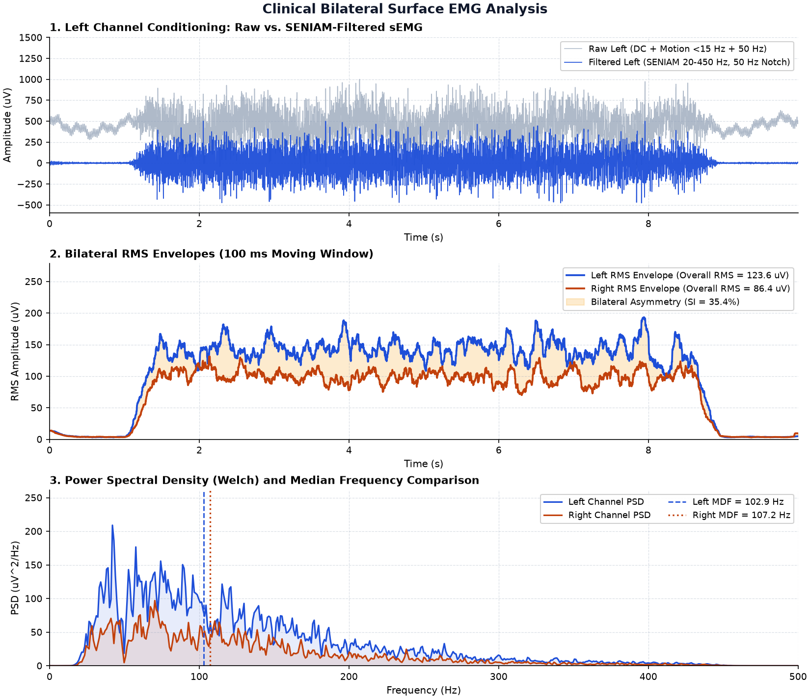

# semg-clinical-pipeline

## Overview and Clinical Motivation

`semg-clinical-pipeline` is a Python 3.11 biomedical signal processing pipeline for SENIAM-compliant preprocessing, quantitative neuromuscular biomarker extraction, and structured clinical reporting of bilateral surface electromyography (sEMG) recordings.

In neurorehabilitation (e.g., post-stroke hemiparesis, anterior cruciate ligament reconstruction, peripheral nerve recovery) and isometric fatigue monitoring, raw sEMG signals are routinely corrupted by electrode-skin half-cell DC offsets, low-frequency motion artifacts (<20 Hz), and AC powerline interference. This pipeline standardizes signal conditioning according to SENIAM guidelines and extracts reproducible time-domain, spectral, and bilateral metrics:

- **Activation Amplitude (RMS, uV):** Quantifies overall neuromuscular recruitment intensity.
- **Spectral Characteristics (MDF, MNF, Hz):** Estimates Welch power spectral density median and mean frequencies, sensitive to muscle fiber conduction velocity.
- **Neuromuscular Fatigue Slope (Hz/s):** Computes the linear regression slope of active-epoch median frequency over time; a negative slope (`< -0.1 Hz/s`) reflects spectral compression associated with progressive localized muscle fatigue.
- **Bilateral Symmetry Index (SI, %):** Applies the Robinson Symmetry Index (`|L - R| / (0.5 * (L + R)) * 100%`) to flag clinically significant inter-limb asymmetry (`> 15.0%`).

All outputs are schema-validated with Pydantic v2 for reliable JSON serialization into clinical dashboards, longitudinal databases, or downstream reporting systems.

## Hardware Compatibility

The input schema is designed for 2-channel, 1000 Hz differential sEMG acquisition front-ends such as an **ESP32-S3 paired with a Texas Instruments ADS1292** 24-bit analog front-end:

- **Sampling rate:** `1000.0 Hz` (`1 ms` sample interval; Nyquist frequency `500 Hz`, supporting the full `20-450 Hz` SENIAM passband).
- **CSV columns:** `timestamp_ms`, `ch1_left_uv`, `ch2_right_uv` (calibrated microvolts).
- **Mains rejection default:** `50.0 Hz` high-Q notch (`Q = 30.0`, Chilean/European power grid standard; configurable via [`preprocess_channel`](src/filters.py)).

> **Synthetic Dataset Notice:** The included dataset (`data/sample_emg_2ch.csv`, generated by `src/synthetic_emg.py`) is **100% synthetic** and does not contain human subject or patient data. It simulates a 10-second bilateral quadriceps isometric contraction with ~30% right-side amplitude attenuation, progressive second-half spectral compression, DC offsets, <15 Hz motion artifacts, and 50 Hz interference for reproducible benchmarking and verification.

## Architecture and Workflow

```text
+------------------------------------------------------------------------+
|  data/sample_emg_2ch.csv (2-ch, 1000 Hz: timestamp_ms, ch1, ch2 uV)    |
|  [Generated by src/synthetic_emg.py or streamed from ESP32-S3+ADS1292] |
+-----------------------------------+------------------------------------+
                                    |
                                    v
+------------------------------------------------------------------------+
|  src/filters.py (SENIAM-Compliant Zero-Phase Conditioning)             |
|    1. DC Offset Removal (mean subtraction)                             |
|    2. 4th-Order Butterworth Bandpass (20-450 Hz, SOS filtfilt)         |
|    3. IIR Notch Filter (50 Hz, Q=30, filtfilt)                         |
|    4. Moving RMS Envelope (100 ms reflective window)                   |
+-------------------+-------------------------------+--------------------+
                    |                               |
                    v                               v
+-----------------------------------+   +--------------------------------+
|  src/features.py                  |   |  src/visualizer.py             |
|    - RMS Amplitude (uV)           |   |    - Panel 1: Raw vs. Filtered |
|    - Welch PSD MDF & MNF (Hz)     |   |    - Panel 2: Bilateral RMS    |
|    - Epoch MDF Fatigue Slope      |   |    - Panel 3: Welch PSD + MDF  |
|    - Robinson Symmetry Index (%)  |   +---------------+----------------+
|    - Pydantic v2 Schema Models    |                   |
+-------------------+---------------+                   |
                    |                                   |
                    v                                   v
+------------------------------------------------------------------------+
|  main.py (CLI Orchestration and Clinical Reporting)                    |
|    -> results/biomarkers.json       (Validated Pydantic JSON export)   |
|    -> results/clinical_summary.md   (Structured Markdown report)       |
|    -> results/emg_clinical_plot.png (150 DPI 3-panel clinical figure)  |
+------------------------------------------------------------------------+
```

## Quickstart

Install dependencies (Python 3.11+ recommended):

```bash
pip install -r requirements.txt
```

Run the end-to-end clinical processing pipeline (use `--regenerate` to force regeneration of `data/sample_emg_2ch.csv`):

```bash
python main.py
```

Execute the unit and integration test suite:

```bash
pytest -v
```

## Sample Results

Results produced by `python main.py` on the deterministic synthetic bilateral quadriceps isometric contraction (`fs = 1000.0 Hz`, `duration = 10.00 s`, `seed = 42`):

| Biomarker | Left Channel | Right Channel | Delta (Right - Left) |
| --- | ---: | ---: | ---: |
| RMS Amplitude (uV) | 123.55 | 86.41 | -37.14 |
| Median Frequency, MDF (Hz) | 102.91 | 107.24 | +4.33 |
| Mean Frequency, MNF (Hz) | 126.00 | 126.75 | +0.75 |
| Fatigue Slope (Hz/s) | -7.34 | -7.15 | +0.19 |

- **Bilateral Symmetry Index (SI):** `35.38%` (dominant side: `left`) — **FLAGGED** (`> 15.0%` clinical asymmetry threshold).
- **Neuromuscular Fatigue:** **FLAGGED (bilateral)** — both channels exhibit active-epoch MDF regression slopes below `-0.1 Hz/s`.


