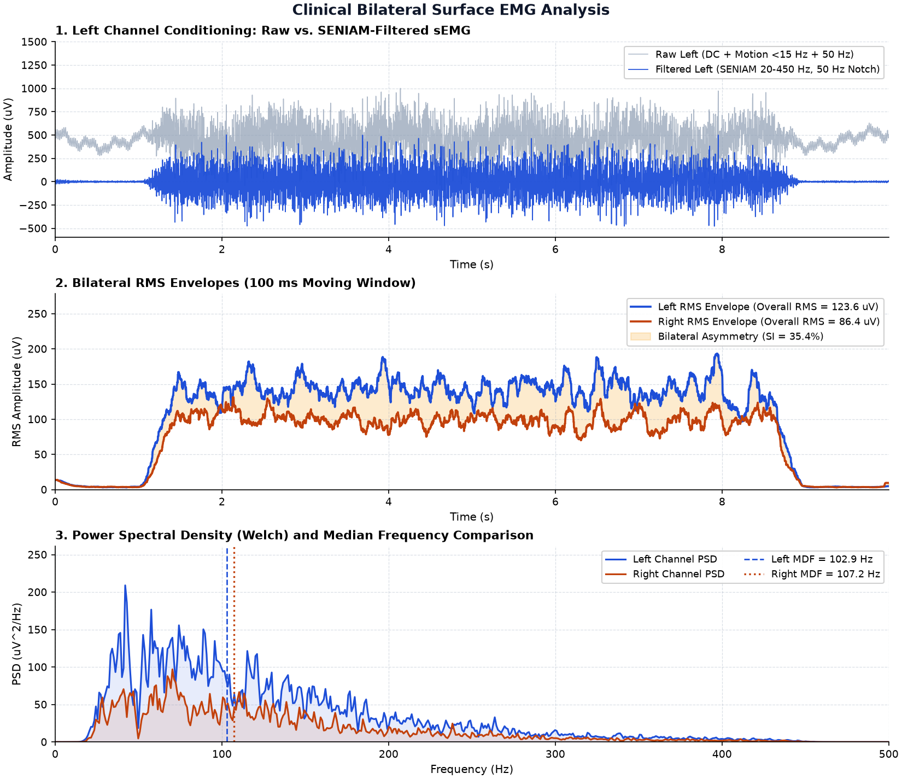

# Clinical Surface EMG Assessment Summary

## Acquisition Parameters

- **Sampling Rate:** 1000.0 Hz
- **Recording Duration:** 10.00 s
- **Preprocessing:** DC offset removal, SENIAM 20-450 Hz 4th-order zero-phase Butterworth bandpass, 50 Hz notch (Q=30), 100 ms moving RMS envelope

## Bilateral Biomarker Comparison

| Biomarker | Left Channel | Right Channel | Delta (Right - Left) |
| --- | ---: | ---: | ---: |
| RMS Amplitude (uV) | 123.55 | 86.41 | -37.14 |
| Median Frequency, MDF (Hz) | 102.91 | 107.24 | +4.33 |
| Mean Frequency, MNF (Hz) | 126.00 | 126.75 | +0.75 |
| Fatigue Slope (Hz/s) | -7.34 | -7.15 | +0.19 |

## Bilateral Symmetry and Clinical Interpretation

- **Bilateral Symmetry Index (SI):** 35.38%
- **Dominant Side (Higher RMS):** left
- **Asymmetry Flag (> 15.0% threshold):** FLAGGED: Clinically significant asymmetry
  - Symmetry Index is 35.38% (exceeds 15.0% threshold), indicating reduced activation on the right side relative to the left side.
- **Fatigue Flag (MDF slope < -0.1 Hz/s):** FLAGGED: Progressive bilateral neuromuscular fatigue
  - Both channels exhibit negative MDF slopes below -0.1 Hz/s (Left: -7.34 Hz/s, Right: -7.15 Hz/s).

## Visual Analysis

